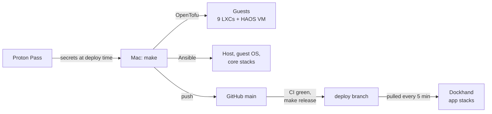

# Proxmox Infra

My homelab as code: one Proxmox server at home running 10 guests and 36 Docker stacks, rebuilt from this
repo, a password manager vault and a data restore.

## Why

Everything I self-host runs on one small box: DNS for the house, cameras, photos, media, Home Assistant,
and a few dozen apps. Built by hand, a dead NVMe or a bad upgrade would mean days of remembering how
everything was set up. Here every setting lives in git, every secret in one vault, and a full rebuild is a
runbook of about 3 hours, most of it unattended.

It's also practice in running infrastructure properly: least-privilege tokens, CI before anything
ships, pull-based deploys, pinned and scanned dependencies, decision records. The repo is
public, so none of it may contain a secret or a home address.

| Hardware | Guests | Docker | Exposed to the internet | Rebuild |
|---|---|---|---|---|
| GMKtec G3 Plus, Intel N150, NVMe + USB disk | 9 LXCs, 1 VM | 36 stacks, 56 containers | Plex only | ~3 h |

## How it works



- OpenTofu (`bpg/proxmox`) creates the LXCs and the Home Assistant VM, with encrypted state in the repo.
- Ansible configures the host, the root-only container settings and every guest.
- Dockhand deploys the Docker stacks in `stacks/` from a `deploy` branch that only moves after CI passes.
- Secrets stay in Proton Pass; the repo holds `pass://` references. Site values (domain, addresses) live
  in the gitignored `homelab.env`.
- CI lints, validates and scans for secrets and misconfigurations. It never deploys.
- No app is published to the internet: everything goes through Traefik and Authelia, reached over the
  LAN or Tailscale.

## Getting started

```bash
brew install opentofu ansible ansible-lint yamllint gitleaks trivy gh jq protonpass/tap/pass-cli
cp homelab.env.example homelab.env   # fill in your values
make init ENV=lab && make lint
```

The vault token and SSH key setup are in [workstation.md](docs/runbooks/workstation.md); a full rebuild is
in [install.md](docs/runbooks/install.md).

## Commands

| Command | What |
|---|---|
| `make lint` | Everything CI runs, plus the leak check against your `homelab.env` |
| `make init ENV=...` | `tofu init` and workspace |
| `make plan ENV=...` | `tofu plan` with the read-only token |
| `make guests ENV=...` | `tofu apply`, then the root-only container config |
| `make apply` / `make destroy ENV=...` | OpenTofu only |
| `make host-check` / `make host` | Host baseline: dry run / apply |
| `make devices-check ENV=...` | Dry run of the root-only container config |
| `make config-check` / `make config ENV=...` | Guest roles: dry run / apply |
| `make apps ENV=...` | Docker engines, stack secrets, core stacks, Dockhand setup |
| `make release` | Move `deploy` to `origin/main`, only if CI on that commit is green |
| `make ha-check` / `make ha-deploy` | Home Assistant config: check / deploy and restart |
| `make pin-kernel VERSION=...` / `make unpin-kernel` | When a new kernel breaks passthrough |

`ENV=lab` is the default and only touches the test container. `apply`, `guests` and `destroy` with
`ENV=prod` need `CONFIRM=yes`.

## Documentation

| Doc | Covers |
|---|---|
| [Architecture](docs/architecture.md) | Guests, layers, config flow, requests, deploys, schedules, logs and alerts |
| [Security](docs/security.md) | Access and privilege model, secrets, credentials, scanning, accepted trade-offs |
| [Services](docs/services.md) | Docker stacks per host, Dockhand, stack conventions, DNS |
| [Host baseline](docs/host-baseline.md) | What `pve_host` does to Proxmox, and why |
| [Home Assistant](docs/home-assistant-as-code.md) | The HA VM as code, secrets, backups, updates |
| [Decision records](docs/adr/README.md) | Why it's built this way, and what each choice costs |
| [Workstation](docs/runbooks/workstation.md) | Setting up the Mac that runs everything |
| [Credentials](docs/runbooks/credentials.md) | Every vault item and field, creating and rotating them |
| [Lab testing](docs/runbooks/lab-testing.md) | Dry runs against the server and the throwaway CT 990 |
| [Release](docs/runbooks/release.md) | Shipping a change, checks, rollback |
| [Install](docs/runbooks/install.md) | Full rebuild, first logins, verification, restore from PBS |

## Trade-offs

One node, no off-site backup yet, a privileged container for the Coral and webcam, the vault needed for a
rebuild, self-signed Proxmox certificates not verified. Reasons in
[security.md](docs/security.md#accepted-trade-offs).

## Tech stack

<table>
<tr><th colspan="6" align="left">Platform and IaC</th></tr>
<tr><td align="center" width="16%"><picture><source media="(prefers-color-scheme: dark)" srcset="https://raw.githubusercontent.com/homarr-labs/dashboard-icons/main/svg/proxmox-light.svg"></picture><br><a href="https://www.proxmox.com/en/products/proxmox-virtual-environment/overview">Proxmox VE</a><br><sub>Hypervisor</sub></td><td align="center" width="16%"><br><a href="https://opentofu.org">OpenTofu</a><br><sub>Creates the Guests</sub></td><td align="center" width="16%"><picture><source media="(prefers-color-scheme: dark)" srcset="https://raw.githubusercontent.com/homarr-labs/dashboard-icons/main/svg/ansible-light.svg"></picture><br><a href="https://www.ansible.com">Ansible</a><br><sub>Configures Host and Guests</sub></td><td align="center" width="16%"><br><a href="https://www.debian.org">Debian</a><br><sub>LXC OS</sub></td><td align="center" width="16%"><br><a href="https://ubuntu.com">Ubuntu</a><br><sub>Plex LXC OS</sub></td><td align="center" width="16%"><br><a href="https://www.docker.com">Docker</a><br><sub>Runs the Stacks</sub></td></tr>
<tr><td align="center" width="16%"><br><a href="https://dockhand.pro">Dockhand</a><br><sub>Deploys Stacks from Git</sub></td><td align="center" width="16%"><br><a href="https://github.com/Finsys/hawser">Hawser</a><br><sub>Dockhand's Remote Agent</sub></td><td align="center" width="16%"><br><a href="https://www.home-assistant.io">Home Assistant</a><br><sub>Smart Home, YAML in Git</sub></td><td align="center" width="16%"><picture><source media="(prefers-color-scheme: dark)" srcset="https://raw.githubusercontent.com/homarr-labs/dashboard-icons/main/svg/proxmox-backup-server-light.svg"></picture><br><a href="https://www.proxmox.com/en/products/proxmox-backup-server/overview">Proxmox Backup Server</a><br><sub>Guest Backups</sub></td></tr>
<tr><th colspan="6" align="left">CI, Updates and Secrets</th></tr>
<tr><td align="center" width="16%"><picture><source media="(prefers-color-scheme: dark)" srcset="https://svgl.app/library/github_dark.svg"></picture><br><a href="https://github.com">GitHub</a><br><sub>Repo, Deploy Source</sub></td><td align="center" width="16%"><br><a href="https://github.com/features/actions">GitHub Actions</a><br><sub>Checks, Never Deploys</sub></td><td align="center" width="16%"><br><a href="https://docs.renovatebot.com">Renovate</a><br><sub>Dependency Update PRs</sub></td><td align="center" width="16%"><br><a href="https://gitleaks.io">Gitleaks</a><br><sub>Secret Scan</sub></td><td align="center" width="16%"><br><a href="https://trivy.dev">Trivy</a><br><sub>Misconfiguration Scan</sub></td><td align="center" width="16%"><br><a href="https://github.com/adrienverge/yamllint">yamllint</a><br><sub>YAML Lint</sub></td></tr>
<tr><td align="center" width="16%"><picture><source media="(prefers-color-scheme: dark)" srcset="https://raw.githubusercontent.com/homarr-labs/dashboard-icons/main/svg/ansible-light.svg"></picture><br><a href="https://ansible.readthedocs.io/projects/lint/">ansible-lint</a><br><sub>Ansible Lint</sub></td><td align="center" width="16%"><br><a href="https://proton.me/pass">Proton Pass</a><br><sub>Secrets Vault</sub></td></tr>
<tr><th colspan="6" align="left">Network and Security</th></tr>
<tr><td align="center" width="16%"><br><a href="https://traefik.io/traefik">Traefik</a><br><sub>Reverse Proxy, TLS</sub></td><td align="center" width="16%"><br><a href="https://www.authelia.com">Authelia</a><br><sub>SSO with 2FA</sub></td><td align="center" width="16%"><br><a href="https://letsencrypt.org">Let's Encrypt</a><br><sub>Wildcard Certificate</sub></td><td align="center" width="16%"><br><a href="https://www.cloudflare.com">Cloudflare</a><br><sub>DNS, ACME Challenge</sub></td><td align="center" width="16%"><picture><source media="(prefers-color-scheme: dark)" srcset="https://raw.githubusercontent.com/homarr-labs/dashboard-icons/main/svg/tailscale-light.svg"></picture><br><a href="https://tailscale.com">Tailscale</a><br><sub>Remote Access</sub></td><td align="center" width="16%"><br><a href="https://adguard.com/en/adguard-home/overview.html">AdGuard Home</a><br><sub>LAN DNS, Ad Blocking</sub></td></tr>
<tr><td align="center" width="16%"><br><a href="https://www.keepalived.org">keepalived</a><br><sub>DNS Failover IP</sub></td><td align="center" width="16%"><br><a href="https://github.com/qdm12/gluetun">Gluetun</a><br><sub>VPN for Containers</sub></td><td align="center" width="16%"><br><a href="https://github.com/wollomatic/socket-proxy">Socket Proxy</a><br><sub>Read-Only Docker API</sub></td><td align="center" width="16%"><br><a href="https://www.clamav.net">ClamAV</a><br><sub>Scans the USB Disk</sub></td><td align="center" width="16%"><br><a href="https://www.samba.org">Samba</a><br><sub>Windows File Share</sub></td></tr>
<tr><th colspan="6" align="left">Monitoring and Alerts</th></tr>
<tr><td align="center" width="16%"><br><a href="https://prometheus.io">Prometheus</a><br><sub>Metrics</sub></td><td align="center" width="16%"><br><a href="https://grafana.com/oss/grafana/">Grafana</a><br><sub>Dashboards, Alerts</sub></td><td align="center" width="16%"><br><a href="https://grafana.com/oss/loki/">Loki</a><br><sub>Logs, 30 Days</sub></td><td align="center" width="16%"><br><a href="https://grafana.com/oss/alloy-opentelemetry-collector/">Alloy</a><br><sub>Log Shipping</sub></td><td align="center" width="16%"><picture><source media="(prefers-color-scheme: dark)" srcset="https://raw.githubusercontent.com/homarr-labs/dashboard-icons/main/svg/beszel-light.svg"></picture><br><a href="https://beszel.dev">Beszel</a><br><sub>Host and Container Stats</sub></td><td align="center" width="16%"><br><a href="https://dozzle.dev">Dozzle</a><br><sub>Live Logs</sub></td></tr>
<tr><td align="center" width="16%"><picture><source media="(prefers-color-scheme: dark)" srcset="https://raw.githubusercontent.com/homarr-labs/dashboard-icons/main/svg/scrutiny-light.svg"></picture><br><a href="https://github.com/AnalogJ/scrutiny">Scrutiny</a><br><sub>Disk Health</sub></td><td align="center" width="16%"><br><a href="https://github.com/alexjustesen/speedtest-tracker">Speedtest Tracker</a><br><sub>Internet and VPN Speed Tests</sub></td><td align="center" width="16%"><picture><source media="(prefers-color-scheme: dark)" srcset="https://raw.githubusercontent.com/homarr-labs/dashboard-icons/main/svg/librespeed-light.svg"></picture><br><a href="https://github.com/librespeed/speedtest">LibreSpeed</a><br><sub>LAN Speed Test</sub></td><td align="center" width="16%"><br><a href="https://changedetection.io">changedetection.io</a><br><sub>Website Change Alerts</sub></td><td align="center" width="16%"><br><a href="https://ntfy.sh">ntfy</a><br><sub>Push Notifications</sub></td><td align="center" width="16%"><br><a href="https://gethomepage.dev">Homepage</a><br><sub>Start Page</sub></td></tr>
<tr><th colspan="6" align="left">Media and Home</th></tr>
<tr><td align="center" width="16%"><picture><source media="(prefers-color-scheme: dark)" srcset="https://raw.githubusercontent.com/homarr-labs/dashboard-icons/main/svg/plex-light.svg"></picture><br><a href="https://www.plex.tv">Plex</a><br><sub>Media Server</sub></td><td align="center" width="16%"><br><a href="https://tautulli.com">Tautulli</a><br><sub>Plex Stats</sub></td><td align="center" width="16%"><br><a href="https://github.com/crocodilestick/Calibre-Web-Automated">Calibre-Web Automated</a><br><sub>E-Books</sub></td><td align="center" width="16%"><br><a href="https://github.com/alexta69/metube">MeTube</a><br><sub>Video Downloads</sub></td><td align="center" width="16%"><br><a href="https://www.qbittorrent.org">qBittorrent</a><br><sub>Torrents</sub></td><td align="center" width="16%"><picture><source media="(prefers-color-scheme: dark)" srcset="https://raw.githubusercontent.com/homarr-labs/dashboard-icons/main/svg/frigate-light.svg"></picture><br><a href="https://frigate.video">Frigate</a><br><sub>Camera NVR</sub></td></tr>
<tr><td align="center" width="16%"><br><a href="https://github.com/bluenviron/mediamtx">MediaMTX</a><br><sub>Webcam Audio for Frigate</sub></td><td align="center" width="16%"><br><a href="https://immich.app">Immich</a><br><sub>Photos</sub></td><td align="center" width="16%"><br><a href="https://kasm.com">Kasm Workspaces</a><br><sub>Browser Desktops</sub></td></tr>
<tr><th colspan="6" align="left">Productivity and Tools</th></tr>
<tr><td align="center" width="16%"><br><a href="https://mealie.io">Mealie</a><br><sub>Recipes</sub></td><td align="center" width="16%"><br><a href="https://freshrss.org">FreshRSS</a><br><sub>RSS</sub></td><td align="center" width="16%"><br><a href="https://wallosapp.com">Wallos</a><br><sub>Subscriptions</sub></td><td align="center" width="16%"><br><a href="https://vikunja.io">Vikunja</a><br><sub>Tasks</sub></td><td align="center" width="16%"><br><a href="https://usememos.com">Memos</a><br><sub>Notes</sub></td><td align="center" width="16%"><br><a href="https://linkding.link">linkding</a><br><sub>Bookmarks</sub></td></tr>
<tr><td align="center" width="16%"><br><a href="https://github.com/C4illin/ConvertX">ConvertX</a><br><sub>File Conversion</sub></td><td align="center" width="16%"><br><a href="https://www.stirlingpdf.com">Stirling-PDF</a><br><sub>PDF Tools</sub></td><td align="center" width="16%"><br><a href="https://excalidraw.com">Excalidraw</a><br><sub>Whiteboard</sub></td><td align="center" width="16%"><br><a href="https://docs.searxng.org">SearXNG</a><br><sub>Search</sub></td><td align="center" width="16%"><br><a href="https://github.com/coder/code-server">code-server</a><br><sub>VS Code in the Browser</sub></td><td align="center" width="16%"><br><a href="https://forgejo.org">Forgejo</a><br><sub>Git Mirror</sub></td></tr>
<tr><td align="center" width="16%"><br><a href="https://github.com/gtsteffaniak/filebrowser">File Browser Quantum</a><br><sub>Web File Manager</sub></td><td align="center" width="16%"><br><a href="https://syncthing.net">Syncthing</a><br><sub>File Sync</sub></td><td align="center" width="16%"><br><a href="https://rustdesk.com">RustDesk</a><br><sub>Remote Desktop Server</sub></td><td align="center" width="16%"><br><a href="https://github.com/RayLabsHQ/gitea-mirror">Gitea Mirror</a><br><sub>GitHub Backup</sub></td></tr>
<tr><th colspan="6" align="left">Databases</th></tr>
<tr><td align="center" width="16%"><br><a href="https://www.postgresql.org">PostgreSQL</a><br><sub>Immich DB</sub></td><td align="center" width="16%"><br><a href="https://valkey.io">Valkey</a><br><sub>Immich Cache</sub></td><td align="center" width="16%"><br><a href="https://www.influxdata.com">InfluxDB</a><br><sub>Scrutiny Metrics</sub></td></tr>
</table>
