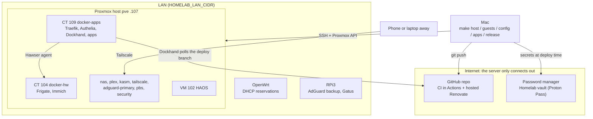
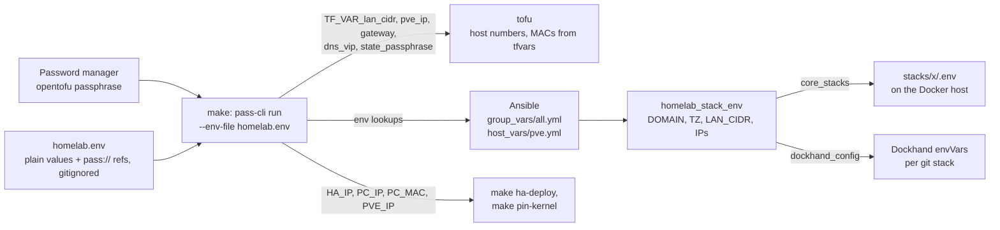
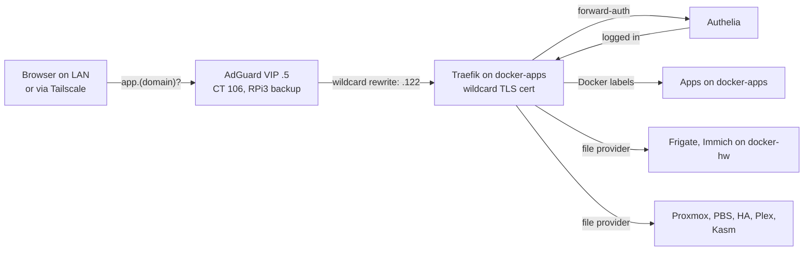
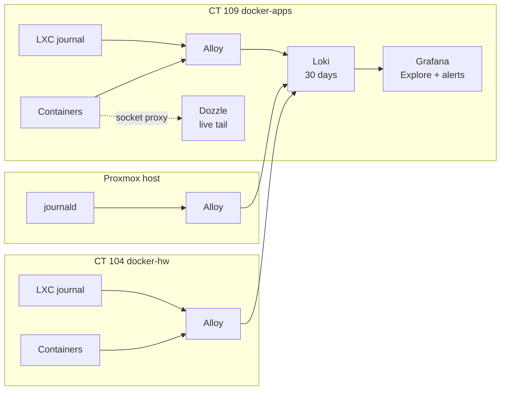
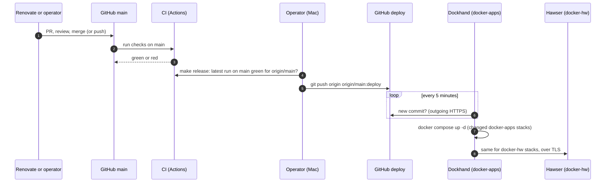
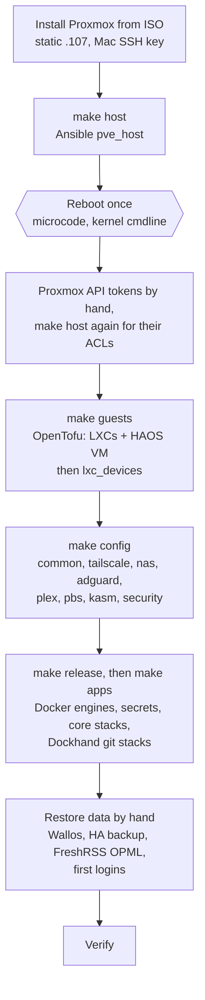

# Architecture

A single-node Proxmox VE 9 server (GMKtec NucBox G3 Plus, Intel N150, one NVMe, one USB backup/data disk)
runs 10 guests and about 40 containerised services. This repo rebuilds all of it from code and secrets in
a password manager vault. Apps start empty, except the few listed in the
[install runbook](runbooks/install.md#3-restore-data-and-first-logins-manual-1-h).

The repo covers the Proxmox host, its LXCs, the Home Assistant VM and every container on them. These are
outside the repo: the OpenWrt router, the Raspberry Pi 3 (AdGuard backup, keepalived BACKUP and Gatus),
PiKVM, and the Cloudflare and Tailscale account settings. Guest IPs and MACs are fixed in `tofu/prod.tfvars` to match the
router's DHCP reservations and the Plex port forward.

## Overview



## Guests

Addresses in these docs are written as host numbers in `HOMELAB_LAN_CIDR`: .122 is docker-apps, and
`<lan>.122` its full address. IDs, MACs and host numbers are fixed in `tofu/prod.tfvars` (`host = 122`)
and match the router's DHCP reservations. The inventory (`ansible/inventory/prod.yml`) repeats the host
numbers for Ansible, which assumes a /24.

| ID | Guest | OS | Address | Privileged | Purpose |
|---|---|---|---|---|---|
| 100 | nas | Debian 13 | .180 | no (uid/gid 1000-1001 mapped) | Samba share of the USB disk for the Windows PC |
| 101 | plex | Ubuntu 26.04 | .113 | no | Plex with iGPU transcoding |
| 102 | haos (VM) | HAOS 18.3 | .118 (`HA_IP`, DHCP reservation) | VM | Home Assistant |
| 103 | kasm | Debian 13 | .117 | no | Kasm Workspaces (8 workspaces, optional VPN egress) |
| 104 | docker-hw | Debian 13 | .120 | yes | Frigate (Coral, webcam, iGPU), Immich |
| 105 | tailscale | Debian 13 | .121 | no | Subnet router + exit node |
| 106 | adguard-primary | Debian 13 | .4 (+ VIP .5) | no | DNS, keepalived MASTER |
| 108 | pbs | Debian 13 | .132 | no | Proxmox Backup Server, datastore on the USB disk |
| 109 | docker-apps | Debian 13 | .122 | no (uid/gid 1000-1001 mapped) | Traefik, Authelia, Dockhand, every other app |
| 110 | security | Debian 13 | .133 | no (uid/gid 1000-1001 mapped) | ClamAV: scheduled scans of the USB disk, mounted read-only |
| 990 | iac-test | Debian 13 | .90 | no | Throwaway test container (lab only) |

Boot order: DNS first (adguard), then pbs, nas and tailscale, docker-apps, docker-hw and HAOS, plex,
kasm and security. Deletion protection is on for adguard-primary, pbs and HAOS.

## Layers and tools

| Layer | Tool | What it covers |
|---|---|---|
| 0. Bare metal | Manual ISO install via PiKVM | Proxmox on the NVMe, static .107, the Mac's SSH key (see the install runbook) |
| 1. Host | Ansible `pve_host` | Repos, updates, key-only SSH, network, boot parameters, timers, templates, OpenTofu's API user ([host-baseline.md](host-baseline.md)) |
| 2. Guests | OpenTofu (`bpg/proxmox`) + Ansible `lxc_devices` | OpenTofu sets IDs, CPU/RAM/disk, the NIC with its fixed MAC/IP, template, startup and protection. Ansible sets everything only `root@pam` may set (bind mounts, device passthrough, raw `lxc.*` lines, `keyctl`/`fuse`, uid mapping), see [ADR 3](adr/3-root-only-steps-in-ansible.md) |
| 3. Guest OS | Ansible roles per guest + `common` | Samba, Plex, Kasm, Tailscale, AdGuard + keepalived, PBS, ClamAV, Docker engines; unattended upgrades, key-only SSH, Beszel agent |
| 4. Containers | Compose files + Dockhand git stacks | Core stacks bootstrapped by Ansible, everything else deployed by Dockhand from `stacks/` on the `deploy` branch |
| 5. Site values and secrets | `homelab.env` + password manager vault | Site values in the gitignored `homelab.env`; secrets as `pass://` references (`homelab.env`, `*.tpl`), resolved at deploy time ([ADR 2](adr/2-secrets-and-site-values.md), [security.md](security.md#secrets)) |
| 6. Updates | Renovate (hosted app) | Image tags and digests, OpenTofu providers, GitHub Actions, CI tool versions |
| 7. CI | GitHub Actions | Lint, validate, secret scan, misconfiguration scan, LAN-address check. It only checks; `make release` reads its result |
| 8. Data | USB disk, HA backups, PBS | Immich, Frigate and media stay on the USB disk; HA comes back from its own backup; PBS holds every guest as the fallback |

## Repo layout

```plain text
├── Makefile                  # every operator command
├── homelab.env.example       # every site variable with placeholders; copy to homelab.env (gitignored)
├── requirements-ci.txt       # pinned yamllint and ansible-lint for CI
├── .github/                  # CI workflow (ci.yml), Renovate config
├── tofu/                     # providers.tf, variables.tf, lxc.tf, vm.tf, lab.tfvars, prod.tfvars
│   └── terraform.tfstate.d/  # encrypted state per workspace (lab, prod)
├── ansible/
│   ├── inventory/            # lab.yml, prod.yml, group_vars/ (site values, stack lists), host_vars/pve.yml
│   ├── playbooks/            # pve-host.yml, guests.yml, config.yml, apps.yml
│   ├── requirements.yml      # collections (community.proxmox, for make config-check)
│   └── roles/                # pve_host, lxc_devices, common, ...
├── stacks/                   # one folder per Docker stack (compose.yml + secrets/*.tpl); check.sh
├── homeassistant/            # config/ (packages, dashboards, secrets.yaml.tpl), check.sh, deploy.sh
└── docs/
```

`make` targets take `ENV=lab` (default) or `ENV=prod`. Each environment has its own OpenTofu workspace and
encrypted state, so the lab can never touch the real guests. `apply` and `destroy` with `ENV=prod` need
`CONFIRM=yes`.

## Site values

The domain, host address and other site values live in `homelab.env`, which is gitignored; a copy is kept
in the vault ([workstation.md](runbooks/workstation.md#site-values)). The Makefile runs its commands under
`pass-cli run --env-file homelab.env`, which passes the plain values through and resolves the `pass://`
references ([ADR 2](adr/2-secrets-and-site-values.md)).



- Every Docker stack gets the same `homelab_stack_env` dict (`group_vars/all.yml`): `DOMAIN`, `TZ`,
  `LATITUDE`/`LONGITUDE`, `LAN_CIDR`, `DNS_VIP`, `GATEWAY_IP` and an `*_IP` for every guest and network
  device the stacks talk to. Core stacks read it from the `.env` next to their `compose.yml`; git stacks
  get it as Dockhand env vars. Compose files use `${VAR}`, Traefik's file provider `{{ env "VAR" }}`,
  Homepage `HOMEPAGE_VAR_*`.
- Guest host numbers, MACs and VMIDs stay in `tofu/*.tfvars` and the inventory host entries; the guest
  IPs in `homelab_stack_env` come from the inventory.

## Request flow

No app is published to the internet. Every app is reached over the LAN or Tailscale, under one wildcard
certificate. The router forwards only one port, Plex (32400 to plex), which bypasses Traefik.



Why it is built this way is in [ADR 6](adr/6-private-access-and-sso.md); DNS details are in
[services.md](services.md#dns-adguard).

## Logging



Grafana (Loki) searches all logs for 30 days and alerts on errors. Dozzle tails one container live.
Docker keeps at most 3 x 10 MB of local logs per
container (`/etc/docker/daemon.json`).

## Notifications

All alerts go to a self-hosted ntfy on docker-apps, which the phone reaches over Tailscale. Topics are
grouped by category, and every sender has its own write-only token, so one can be revoked alone.

| Topic | Senders | Set in |
|---|---|---|
| `homelab-critical` | Grafana critical alerts; Scrutiny (disk failing, priority max) | Code |
| `homelab-security` | ClamAV detections and failed scans (high) | Code |
| `homelab-infra` | Grafana warnings | Code |
| `homelab-personal` | changedetection, Wallos | Each app's UI |
| `homelab-apps`, `homelab-media` | Nothing yet; the `alerts` user may write to them | |

The phone's ntfy user reads every topic; `homelab-critical` overrides Do Not Disturb there.

Gatus on the RPi3 (port 8080) watches DNS, the network gear and the server from outside it. It alerts
through ntfy.sh on a random topic (set in Gatus' `.env` on the RPi3), so its alerts arrive even when
the server or Tailscale is down.

## Deployment model

Dockhand deploys the `deploy` branch, never `main`. `make release` moves `deploy` to `origin/main`, and
only when the latest CI run on `main` passed for that exact commit
([ADR 4](adr/4-pull-based-deploys.md)).



| Part | How it changes | Automatic? |
|---|---|---|
| App containers | Renovate PR, CI, merge, `make release`, Dockhand redeploys | Two manual steps (merge, release) |
| LXCs: Debian stable + security, Ubuntu `-security`/`-updates` (pbs: security only) | unattended-upgrades, no reboot | Daily |
| LXCs: third-party repos (Docker, Plex, Kasm, Tailscale, PBS) | `apt full-upgrade` on the guest by hand | Manual |
| Host: Debian security updates | unattended-upgrades, Debian-Security only, no reboot | Daily |
| Host: Proxmox packages and kernel | `apt full-upgrade` on the host by hand (`make pin-kernel` if a kernel breaks the iGPU) | Manual |
| Home Assistant: add-ons, HACS, Core, OS | Automation in git, nightly, backup first | Nightly |
| Guests, mounts, passthrough, host/guest config | `make host` / `guests` / `config` / `apps` | Manual, by design |

Infrastructure changes stay manual on purpose. A bad compose update breaks one app and is reverted with one
commit and `make release`, but a bad OpenTofu or host change can recreate a guest or reboot the server.
Nothing on the internet connects into the LAN: every change arrives through a timer on the server, an
outgoing pull from GitHub, or `make` run from the Mac.

## Bootstrap order



Manual steps are listed in the [install runbook](runbooks/install.md). The repo never depends on a
service it creates itself. The only external dependency during a rebuild is the password manager.
