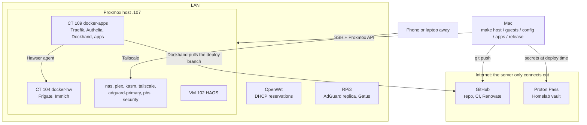
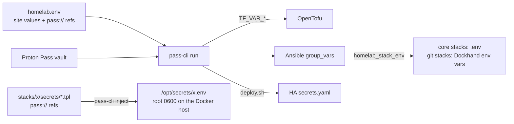
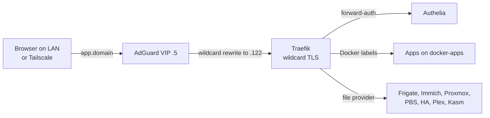
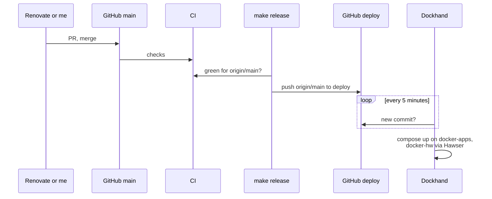

# Architecture

One Proxmox VE 9 server (GMKtec NucBox G3 Plus: Intel N150, one NVMe, one USB disk for data and backups)
runs 9 LXCs and the Home Assistant VM, with 36 Docker stacks (56 containers) on them.

The repo covers the Proxmox host, its guests and every container. It doesn't cover the OpenWrt router, the
Raspberry Pi 3 (AdGuard replica, keepalived BACKUP, Gatus), or the Cloudflare and Tailscale accounts.



## Guests

Addresses are host numbers in `HOMELAB_LAN_CIDR` (.122 is docker-apps). IDs, MACs and host numbers are
fixed in `tofu/prod.tfvars` and match the router's DHCP reservations; the Ansible inventory repeats the
host numbers and assumes a /24.

| ID | Guest | OS | Address | CPU / RAM / disk | Runs |
|---|---|---|---|---|---|
| 100 | nas | Debian 13 | .180 | 2 / 1 GB / 8 GB | Samba share of the USB disk for the Windows PC |
| 101 | plex | Ubuntu 26.04 | .113 | 2 / 2 GB / 8 GB | Plex, iGPU transcoding |
| 102 | haos (VM) | HAOS 18.3 | .118 | 2 / 4 GB / 32 GB | Home Assistant |
| 103 | kasm | Debian 13 | .117 | 4 / 8 GB / 120 GB | Kasm Workspaces |
| 104 | docker-hw | Debian 13 | .120 | 4 / 6 GB / 50 GB | Frigate (Coral, webcam, iGPU), Immich. **Privileged** |
| 105 | tailscale | Debian 13 | .121 | 2 / 512 MB / 8 GB | Subnet router and exit node |
| 106 | adguard-primary | Debian 13 | .4, VIP .5 | 2 / 1 GB / 12 GB | DNS, keepalived MASTER |
| 108 | pbs | Debian 13 | .132 | 2 / 2 GB / 16 GB | Proxmox Backup Server, datastore on the USB disk |
| 109 | docker-apps | Debian 13 | .122 | 4 / 8 GB / 80 GB | Traefik, Authelia, Dockhand, every other app |
| 110 | security | Debian 13 | .133 | 2 / 2 GB / 8 GB | ClamAV scans of the USB disk (read-only) |
| 990 | iac-test | Debian 13 | .90 | 2 / 6 GB / 50 GB | Lab only, throwaway ([lab-testing.md](runbooks/lab-testing.md)) |

Boot order: adguard-primary, pbs, nas + tailscale, docker-apps, docker-hw + HAOS, plex, kasm + security.
adguard-primary, pbs and HAOS have deletion protection.

## Layers

| Layer | Tool | Covers |
|---|---|---|
| Bare metal | ISO, by hand | Proxmox on the NVMe ([install.md](runbooks/install.md)) |
| Host | Ansible `pve_host` | Repos, updates, SSH, boot parameters, timers, templates, API users ([host-baseline.md](host-baseline.md)) |
| Guests | OpenTofu `bpg/proxmox`, then Ansible `lxc_devices` | OpenTofu: IDs, sizes, NIC, template, startup, protection. Ansible: what only `root@pam` may set, like bind mounts and passthrough ([ADR 3](adr/3-root-only-steps-in-ansible.md)) |
| Guest OS | Ansible, one role per guest + `common` | Samba, Plex, Kasm, Tailscale, AdGuard, PBS, ClamAV, Docker; updates, SSH, Beszel agent on all |
| Containers | Compose + Dockhand | Ansible starts the core stacks; Dockhand deploys the rest from the `deploy` branch ([services.md](services.md)) |
| Config and secrets | `homelab.env` + Proton Pass | Resolved at deploy time ([ADR 2](adr/2-secrets-and-site-values.md)) |
| Updates | Renovate | Image tags and digests, providers, actions, CI tools |
| CI | GitHub Actions | Lint, validate, scans. Never deploys |
| Data | USB disk, HA backups, PBS | Immich, Frigate and media stay on the disk; PBS holds every guest |

## Repo layout

```plain text
├── Makefile               # every operator command; ENV=lab (default) or ENV=prod
├── homelab.env.example    # every site variable; copy to homelab.env (gitignored)
├── .github/               # CI workflow, Renovate config
├── tofu/                  # guests (lxc.tf, vm.tf), lab.tfvars, prod.tfvars
│   └── terraform.tfstate.d/  # encrypted state, one workspace per ENV
├── ansible/
│   ├── inventory/         # lab.yml, prod.yml, group_vars/, host_vars/
│   ├── playbooks/         # pve-host, guests, config, apps
│   └── roles/
├── stacks/                # one folder per Docker stack (compose.yml, secrets/*.tpl); check.sh
├── homeassistant/         # config/, check.sh, deploy.sh
└── docs/
```

Each `ENV` has its own OpenTofu workspace and state, so the lab can't touch the real guests.

## Config and secrets

`homelab.env` holds the site values (domain, LAN, addresses, MACs) as plain text and the secrets as
`pass://Homelab/<item>/<field>` references. The Makefile runs every command under
`pass-cli run --env-file homelab.env`, which resolves the references for that one command.



Every stack gets the same `homelab_stack_env` (`DOMAIN`, `TZ`, `LAN_CIDR`, `DNS_VIP`, and an `*_IP` for
each guest and device it talks to). Compose files read it as `${VAR}`, Traefik's file provider as
`{{ env "VAR" }}`, Homepage as `HOMEPAGE_VAR_*`.

## Request flow

Nothing is published to the internet except Plex (port 32400, straight to its LXC). Everything else is
reached over the LAN or Tailscale, under one wildcard certificate ([ADR 6](adr/6-private-access-and-sso.md)).



## Deploys

Dockhand deploys the `deploy` branch, never `main`. `make release` moves `deploy` to `origin/main` only
if the latest CI run on `main` passed for that commit ([ADR 4](adr/4-pull-based-deploys.md)).



| What | How it updates | When |
|---|---|---|
| App containers | Renovate PR, merge, `make release`, Dockhand | On release |
| LXC OS packages (Debian, Ubuntu; pbs security only) | unattended-upgrades, no reboot | Daily |
| LXC third-party repos (Docker, Plex, Kasm, Tailscale, PBS) | `apt full-upgrade` by hand; a weekly ntfy lists what's pending | Manual |
| Host: Debian security | unattended-upgrades, no reboot | Daily |
| Host: Proxmox and kernel | `apt full-upgrade` by hand (`make pin-kernel` if a kernel breaks the iGPU); same weekly list | Manual |
| Home Assistant add-ons, HACS, Core, OS | Automation in git, backup first ([HA doc](home-assistant-as-code.md#updates)) | Nightly |
| Host, guests, roles | `make host` / `guests` / `config` / `apps` | Manual |

Infrastructure stays manual on purpose: a bad compose update breaks one app and is reverted with a
commit, while a bad OpenTofu or host change can recreate a guest or reboot the server.

## Schedules

| When | Where | Job |
|---|---|---|
| Daily 03:00 | security | ClamAV scan of files changed in the last 2 days |
| Daily 03:30 | host, kasm | Scrutiny SMART collection; Kasm database dump |
| Daily 04:30 | HAOS | Pending updates (add-ons and HACS, then Core and OS) |
| Every 3 days 05:00 | host | vzdump of every guest except pbs and security to PBS |
| Daily 09:00 | host | Alert if a guest's newest backup is over 4 days old |
| Mon 09:00 | host | ntfy list of upgrades pending on the host and every LXC |
| Sat 01:00 | security | ClamAV full scan |
| Sun 04:00 | host | `pct fstrim` on every running LXC |
| Sun 04:30 | kasm | Prune untagged Docker images |
| Sun 06:15 | host | PBS config export to the NVMe |
| Sun 07:00 | host | `/etc` + Proxmox config DB to the USB disk, plus a copy of the PBS export |
| Sun 07:15, 08:10, 09:00 | pbs | Prune (last 3, 7 daily, 4 weekly, 2 monthly), garbage collection, verify |

## Logs and alerts

Alloy on docker-apps, docker-hw and the host ships container logs and journals to Loki (30 days). Grafana
searches them and alerts on errors; Dozzle tails one container live. Prometheus keeps 30 days of metrics.
Docker keeps 3 × 10 MB of local logs per container.

All alerts go to a self-hosted ntfy, which the phone reaches over Tailscale. Each sender has its own
write-only token for `homelab-*`, so one can be revoked alone.

| Topic | Senders |
|---|---|
| `homelab-critical` | Grafana critical alerts, Scrutiny disk failures. Overrides Do Not Disturb on the phone |
| `homelab-security` | ClamAV detections and failed scans |
| `homelab-infra` | Grafana warnings; Proxmox and PBS warnings and errors (failed backup, GC, verify, prune); stale backups; the weekly pending-upgrades list |
| `homelab-personal` | changedetection, Wallos (set in each app's UI) |

Gatus on the RPi3 watches DNS, the network gear and the server from outside. It alerts through ntfy.sh on
a random topic, so its alerts still arrive when the server or Tailscale is down. Its config is in
[`gatus/`](../gatus) (`make gatus-deploy`).
