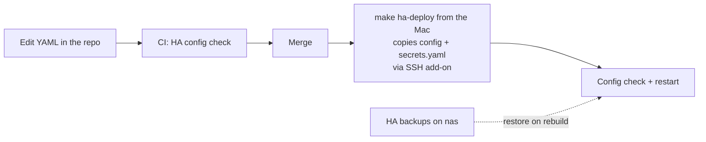

# Home Assistant as code

HAOS is an appliance, so Ansible can't manage it from the inside like an LXC. It is split into five parts,
each handled differently.

| Part | What | How | In git |
|---|---|---|---|
| 1. The VM | VM 102: q35, OVMF, 2 cores, 4 GB, 32 GB disk, serial console, fixed MAC, guest agent, deletion protection | OpenTofu; the disk is imported from the HAOS image that `pve_host` downloads, and a newer image name in tfvars never re-imports it (HAOS updates itself) | Code |
| 2. YAML config | `configuration.yaml` loading packages (Frigate recording, light groups and scene, Wake-on-LAN, nightly auto-update), dashboards in YAML mode, `ip_ban_enabled` with 5 failed logins | `make ha-deploy` (`homeassistant/deploy.sh`) copies `homeassistant/config/` into `/config` through the Terminal & SSH add-on, then runs HA's config check and a restart. CI runs the same check (`make ha-check`) with a dummy `secrets.yaml` | Code |
| 3. Secrets | `secrets.yaml` (the PC's MAC and address for Wake-on-LAN, docker-apps' address as trusted proxy) | `deploy.sh` fills `secrets.yaml.tpl` from `homelab.env` (`PC_MAC`, read from vault item `homeassistant`, field `samurai_mac`; `PC_IP`; `HOMELAB_LAN_CIDR`) and pipes it to HA; never on disk on the Mac | `${VAR}` placeholders only |
| 4. UI-managed state | Integrations, devices, entities, areas, users, helpers, add-on options (`.storage/`) | Restored from HA backups | No |
| 5. Backups | Full HA backups | HA's own scheduled backups to the nas share, plus the PBS backup of the VM (every 3 days) | Data |

`make ha-deploy` runs under `pass-cli run --env-file homelab.env`, which gives `deploy.sh` the VM's address
(`HA_IP`) and the values for `secrets.yaml`. The Wake-on-LAN switch for the PC is `switch.pc`.

A shell script fits better than Ansible here: HAOS has no Python for Ansible to use, and the job is a copy
plus two `ha` commands. HACS items are listed in `homeassistant/hacs.yaml`; they come back with the backup.

The Git pull add-on is not used. It expects the repo root to be the HA config folder, and here HA lives in
a subfolder.

## Rebuild

`make guests` creates VM 102 and HAOS boots to the onboarding screen. Restore the latest backup from nas,
install the Terminal & SSH add-on, then run `make ha-deploy` (secrets.yaml + YAML from the repo, check,
restart).

The Frigate integration's RTSP URL template needs the restream login; the exact template is in the
[install runbook](runbooks/install.md#4-verify).

## Updates

An automation in `packages/auto_update.yaml` installs every pending update nightly at 04:30: add-ons and
HACS first, then Core and OS (they restart HA), with a backup first where the entity supports it. Core
waits for the `.1` patch release instead of taking `x.y.0`. The per-add-on auto-update toggles stay off.
To pause updates, turn the automation off in the UI.
