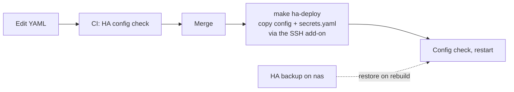

# Home Assistant as code

HAOS is an appliance with no Python, so Ansible can't manage it from inside. It's split into parts that
are each handled differently.

| Part | What | How | In git |
|---|---|---|---|
| VM | VM 102: q35, OVMF, 2 cores, 4 GB, 32 GB, serial console, fixed MAC, guest agent, deletion protection | OpenTofu imports the disk from the image `pve_host` downloads. A newer image name never re-imports it; HAOS updates itself | Yes |
| YAML | `configuration.yaml` with packages (Frigate recording, lights, Wake-on-LAN, nightly updates), YAML dashboards, IP ban after 5 failed logins | `make ha-deploy` | Yes |
| Secrets | `secrets.yaml`: the PC's MAC and IP for Wake-on-LAN, docker-apps' IP as the trusted proxy | `deploy.sh` fills `secrets.yaml.tpl` from `homelab.env` and pipes it to HA; it never lands on the Mac's disk | Template only |
| UI state | Integrations, devices, entities, users, helpers, add-on options (`.storage/`) | Restored from HA backups | No |
| Backups | Full HA backups | HA's own schedule to the nas share, plus PBS every 3 days | No |

`make ha-deploy` runs `homeassistant/deploy.sh`: it copies `homeassistant/config/` into `/config` through
the Terminal & SSH add-on, runs HA's config check and restarts. CI runs the same check (`make ha-check`)
with a dummy `secrets.yaml`. The Git pull add-on isn't used because it expects the repo root to be the
config folder.

HACS items are listed in `homeassistant/hacs.yaml` and come back with the backup. The PC's Wake-on-LAN
switch is `switch.pc`.

## Rebuild

`make guests` creates VM 102, which boots to onboarding. Restore the latest backup from nas, install the
Terminal & SSH add-on, then `make ha-deploy`. The Frigate integration's RTSP URL is in the
[install runbook](runbooks/install.md#4-verify).

## Updates

`packages/auto_update.yaml` installs pending updates every night at 04:30: add-ons and HACS first, then
Core and OS (these restart HA), each with a backup first where the entity supports it. Core skips `x.y.0`
and waits for `x.y.1`. To pause updates, turn the automation off.
