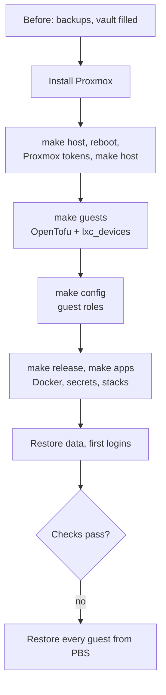

# Install

Rebuilding the server from this repo: what to do before, the install, the build, restoring data, and
checking the result. `make` steps are safe to re-run.

## Before

On the old server, while it still runs:

- [ ] PBS backup of every guest, all succeeded. It's the way back if the rebuild fails.
- [ ] In HA: a long-lived token for Homepage and the Frigate MQTT login, then a full HA backup to the Mac
      and to nas. Both come back with the backup.
- [ ] Immich `pg_dumpall`, `/opt/appdata/wallos/{db,logos}`, FreshRSS feeds as OPML.
- [ ] The vault Note `homelab-env` and every item in [credentials.md](credentials.md), placeholders
      included ([fresh install](credentials.md#filling-the-vault-for-a-fresh-install)).
- [ ] `deploy` points at a green commit (`make release`).

## 1. Install Proxmox (by hand, ~30 min)

1. Unplug the USB disk so the installer can't touch it.
2. Boot the Proxmox ISO and install on the NVMe: hostname `pve`, static `PVE_IP`,
   gateway `HOMELAB_GATEWAY`, root password from the vault, default LVM layout.
3. Forget the old host keys: `ssh-keygen -R $PVE_IP`, and the same for each LXC's IP. Ansible accepts the
   LXCs' new keys on first use.
4. `ssh-copy-id root@$PVE_IP`, then plug the USB disk back in. Don't format it.

## 2. Build (~1-2 h, mostly unattended)

| # | Step | What happens |
|---|---|---|
| 1 | `make host ENV=prod` | Host baseline ([host-baseline.md](../host-baseline.md)), USB disk mounted, templates and HAOS image, API users. SSH is key-only after this |
| 2 | Reboot the host | Loads the microcode and kernel command line |
| 3 | Create the Proxmox tokens, store them in the vault | `tofu@pve` `plan` and `apply`, `monitoring@pve` `exporter` and `homepage` ([credentials.md](credentials.md#proxmox-tokens-for-opentofu)). The role prints the commands for any still missing |
| 4 | `make host ENV=prod` | ACLs for the new tokens |
| 5 | `make guests ENV=prod CONFIRM=yes` | OpenTofu creates every guest, then `lxc_devices` adds the root-only config. **Commit and push** the new encrypted state (`tofu/terraform.tfstate.d/prod/`) |
| 6 | Generate a Tailscale auth key into the `tailscale` item | Single-use and expiring, so right before the next step |
| 7 | `make config ENV=prod` | Every guest role: `common`, tailscale, Samba, AdGuard + keepalived + sync, Plex (unclaimed), PBS, Kasm, ClamAV. PBS re-attaches the datastore on the USB disk and takes over the old backup groups, which takes several minutes the first time |
| 8 | Create the `pbs-homepage` token in PBS, store it | Homepage's PBS widget |
| 9 | `make release` if `main` moved, then `make apps ENV=prod` | Docker engines, Hawser, secrets, core stacks, Dockhand with every git stack |

## 3. Restore data and first logins (by hand, ~1 h)

Docker apps start empty except Wallos: copy `wallos/{db,logos}` back into `/opt/appdata/` on
docker-apps. Data on the USB disk (Immich, Frigate recordings, books, media) isn't touched by a rebuild.

| Service | First run |
|---|---|
| Authelia | Log in and register 2FA again. The one-time links are in `docker exec authelia cat /data/notification.txt` on docker-apps |
| Beszel | Create the login from vault item `beszel`. Add the systems: docker-apps as host `beszel-agent`, every other LXC by IP, port 45876 |
| Immich | Nothing: library and database are on the USB disk |
| Frigate | Settings → Users: the viewer from vault item `frigate` |
| Forgejo | Mirror the GitHub repos |
| changedetection | Add the watches; notifications to ntfy `homelab-personal` |
| FreshRSS | Import the OPML |
| Memos | Create the first account (it becomes admin), then turn off sign-ups |
| Vikunja, Linkding | Nothing: the first Authelia login creates the user |
| Mealie | Log in as `changeme@example.com` / `MyPassword`, change both |
| Plex | Claim it from localhost: `ssh -L 32400:localhost:32400 root@$PLEX_IP`, open `http://localhost:32400/web`, add the libraries. Pair Tautulli |
| Kasm | Log in as `admin@kasm.local` with the password in `/root/kasm-install-logins` on CT 103 and change it. Add the 8 workspaces from the registry and the ProtonVPN egress (vault item `kasm-vpn`). If sessions don't start, set Admin → Infrastructure → Zones → Proxy Port to 443 |
| RustDesk | Give the new public key (`/opt/appdata/rustdesk/hbbs/id_ed25519.pub`) to every client |
| Home Assistant | Onboarding: restore the latest backup, install Terminal & SSH (your public key in its options), then `make ha-deploy` |
| Tailscale | Admin console: turn off key expiry for the `tailscale` machine |

Last, replace the `changeme` placeholders in the vault with the real keys
([credentials.md](credentials.md#filling-the-vault-for-a-fresh-install)) and run `make apps ENV=prod`
again for the Homepage widgets and the Proxmox exporter.

## 4. Verify

- [ ] Plex transcodes on the iGPU; Frigate detects with the Coral; the webcam survives a replug; Immich ML
      runs.
- [ ] HA's Frigate integration connects (`https://frigate.<domain>`, its own login) and streams. Its RTSP
      URL template: `rtsp://<rtsp_user>:<rtsp_password>@<lan>.120:8554/{{ name }}` (vault item `frigate`).
- [ ] The Windows PC opens `\\nas\NAS` with the Samba login.
- [ ] Every `*.<domain>` host loads through Traefik and Authelia; Homepage widgets are green.
- [ ] File Browser shows Books, Downloads, Movies, Shared and Torrents, nothing else.
- [ ] Phone: HA app, Immich app, Tailscale exit node and subnet route (approved in the admin console).
- [ ] AdGuard: the VIP is on CT 106; `journalctl -u adguardhome-sync` there shows a sync to the RPi3.
- [ ] Router DHCP leases show the expected MAC → IP pairs.
- [ ] SSH with a password is refused: `ssh -o PubkeyAuthentication=no root@<host>`.
- [ ] ClamAV: put the EICAR test file into `Downloads` on the share, run
      `systemctl start clamav-scan@changed` on security, and expect a `homelab-security` alert in about
      2 minutes. Delete the file.
- [ ] The first PBS backup job runs; Beszel and Grafana see every guest.
- [ ] Alerts reach ntfy `homelab-infra`: Test on the `ntfy` target in Proxmox (Datacenter → Notifications)
      and in PBS (Configuration → Notifications), then `systemctl start homelab-pending-updates` on the host.
- [ ] Gatus on the RPi3 (port 8080) is all green.

## Restore every guest from PBS

1. Install Proxmox.
2. Bring up something that can read the datastore (PBS itself isn't in it): either `make guests` plus the
   `pbs` role for CT 108 only, or `proxmox-backup-server` installed on the host for the time being.
3. Attach `/mnt/external/Backups`, add it as storage, restore every other guest.

That gets back the last backed-up state (at most 3 days old) within a few hours.
