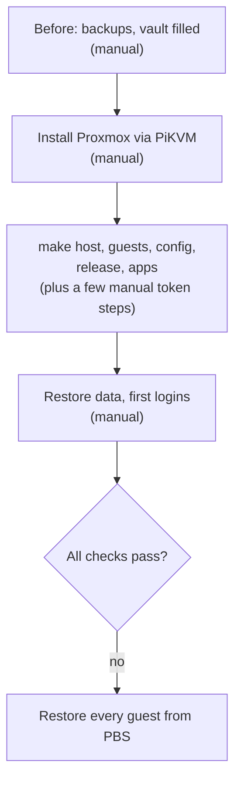

# Install

Installing the server from this repo, the manual steps after it, verifying, and restoring every guest from
PBS. Steps marked `make` are automated and safe to re-run; steps marked manual are yours.

## Before (manual)

- Fresh PBS backup of every guest; check that all succeeded. It is the way back if the rebuild fails.
- HA long-lived token for Homepage and the Frigate MQTT login created in HA, then a full HA backup to the
  Mac and to nas (both come back with the backup).
- Immich `pg_dumpall`, `/opt/appdata/wallos/{db,logos}`, FreshRSS feeds as OPML
  (Subscription management → Export).
- The vault Note `homelab-env` and every item in [credentials.md](credentials.md), placeholders included
  ([fresh install](credentials.md#filling-the-vault-for-a-fresh-install)).
- The `deploy` branch points at a green commit (`make release` once).

## 1. Install Proxmox (manual, ~30 min)

- Unplug the USB disk, so the installer can't touch it.
- Boot the Proxmox ISO from PiKVM virtual media and install on the NVMe: hostname `pve`, static
  `PVE_IP` in `HOMELAB_LAN_CIDR`, gateway `HOMELAB_GATEWAY`, the root password from the vault, default LVM
  layout.
- Forget the old host keys (same IPs, new keys): `ssh-keygen -R $PVE_IP`, and the same for each LXC's IP.
  Ansible trusts the LXCs' new keys on first use.
- `ssh-copy-id root@$PVE_IP`, then plug the USB disk back in. Don't format it: Ansible adds it to fstab.

## 2. Build (~1-2 h, mostly unattended)

| # | Who | Step | What happens |
|---|---|---|---|
| 1 | `make` | `make host ENV=prod` | Host baseline ([host-baseline.md](../host-baseline.md)), USB disk mounted, templates and HAOS image downloaded, users `tofu@pve` and `monitoring@pve`. After this, SSH accepts keys only |
| 2 | manual | Reboot the host | Loads the microcode and the new kernel command line |
| 3 | manual | Create the four Proxmox tokens on the host and store them in the vault | `tofu@pve` `plan` and `apply`, `monitoring@pve` `exporter` and `homepage` ([credentials.md](credentials.md#proxmox-tokens-for-opentofu)); the role prints the commands for any still missing |
| 4 | `make` | `make host ENV=prod` again | ACLs for the new tokens |
| 5 | `make` | `make guests ENV=prod CONFIRM=yes` | OpenTofu creates every guest with its fixed ID, IP and MAC; `lxc_devices` adds the root-only config (USB-disk folders, passthrough, uid mapping). Then commit and push the new encrypted state, `tofu/terraform.tfstate.d/prod/terraform.tfstate` ([ADR 1](../adr/1-opentofu-encrypted-state.md)) |
| 6 | manual | Generate a Tailscale auth key into the `tailscale` item | Single-use and it expires, so right before the next step |
| 7 | `make` | `make config ENV=prod` | `common` on every LXC (updates, key-only SSH, Beszel agent), then tailscale joins, nas (Samba), adguard-primary (AdGuard, keepalived, sync to the RPi3), plex (unclaimed), pbs (re-attaches the datastore on the USB disk, hands its files and backup groups from the old privileged PBS and root@pam to the new unprivileged CT and its token: several minutes the first time, the host's backup token, storage and backup job), kasm (Docker + Kasm), security (ClamAV timers) |
| 8 | manual | Create the `pbs-homepage` token in PBS and store it | Homepage's PBS widget |
| 9 | `make` | `make release` if `main` moved, then `make apps ENV=prod` | Docker engines on docker-apps and docker-hw, Hawser on docker-hw and kasm, secrets rendered, core stacks up, Dockhand set up and every git stack deployed from `deploy` |

## 3. Restore data and first logins (manual, ~1 h)

Every Docker app starts empty except Wallos: copy `wallos/{db,logos}` back into `/opt/appdata/` on
docker-apps. Everything else in `/opt/appdata` starts empty on purpose. Data on the USB disk (Immich,
Frigate recordings, books, media) isn't touched by a rebuild.

Then, per service:

- Authelia starts empty: log in and register 2FA again. The one-time links go to a file on docker-apps:
  `docker exec authelia cat /data/notification.txt`.
- Beszel: create the login from vault item `beszel` on the first-run screen. The hub's key comes from the
  vault, so the agents already trust it. Add the systems: docker-apps as host `beszel-agent`, every other
  LXC by its IP, all on port 45876.
- Immich needs nothing: the library and database are on the USB disk (`/mnt/external/Personal/Immich`).
- Frigate: create the viewer user from vault item `frigate` (`username`, `password`) under Settings → Users.
- Forgejo starts empty; mirror the GitHub repos.
- changedetection starts empty: add the watches again and point its notifications at ntfy
  (`homelab-personal`).
- FreshRSS: import the OPML, then keep only the feeds you still want.
- Memos: create the first account (it becomes admin), then turn off sign-ups. Vikunja: the first login
  through Authelia creates the user. Linkding: nothing (the Authelia user).
- Mealie: log in as `changeme@example.com` / `MyPassword` and change both.
- Plex starts empty. Claim it through an SSH tunnel (a new server only accepts a claim from localhost):
  `ssh -L 32400:localhost:32400 root@$PLEX_IP`, open `http://localhost:32400/web`, sign in, add the
  libraries. Pair Tautulli with the server.
- Kasm starts empty. Log in as `admin@kasm.local` with the password in `/root/kasm-install-logins` on
  CT 103, change it, add the 8 workspaces from the registry, and the ProtonVPN egress gateway (vault item
  `kasm-vpn`) under Admin → Egress. Behind Traefik its zone needs Admin → Infrastructure → Zones → Proxy
  Port 443 if sessions don't start.
- RustDesk makes a new key pair: give the new public key (`/opt/appdata/rustdesk/hbbs/id_ed25519.pub`)
  to every client.
- HAOS: onboarding screen, restore the latest backup, install the Terminal & SSH add-on (your SSH public
  key in its options), `make ha-deploy`.
- Tailscale admin console: turn off key expiry for the `tailscale` machine.

Last, replace the `changeme` placeholders in the vault with the keys and tokens the apps now have
([credentials.md](credentials.md#filling-the-vault-for-a-fresh-install)) and run `make apps ENV=prod`
once more for the Homepage widgets and the Proxmox exporter.

## 4. Verify

- [ ] Plex transcodes on the iGPU; Frigate detects with the Coral; webcam replug works; Immich ML runs.
- [ ] Home Assistant's Frigate integration connects (`https://frigate.<domain>`, its own login) and the
      camera streams. The restream needs the RTSP login, so the integration's RTSP URL template is
      `rtsp://<rtsp_user>:<rtsp_password>@<lan>.120:8554/{{ name }}` (vault item `frigate`).
- [ ] The Windows PC opens `\\nas\NAS` (or `\\<lan>.180\NAS`) with the Samba login.
- [ ] Every `*.<domain>` host loads through Traefik with the Authelia login; Homepage widgets green.
- [ ] File Browser shows Books, Downloads, Movies, Shared and Torrents, and nothing else of the USB disk.
- [ ] Phones: HA app, Immich app, Tailscale exit node and subnet route.
- [ ] Tailscale admin console: `tailscale` shows the subnet route and exit node approved.
- [ ] AdGuard: VIP on CT 106; `journalctl -u adguardhome-sync` on CT 106 shows a successful sync to the
      RPi3.
- [ ] Every guest answers on its fixed IP (router DHCP leases show the expected MAC → IP pairs).
- [ ] SSH with a password is refused on the host and an LXC (`ssh -o PubkeyAuthentication=no root@...`).
- [ ] ClamAV: from the Windows PC put the EICAR test file into `Downloads` on the share, then on security
      run `systemctl start clamav-scan@changed`. A high-priority `homelab-security` alert names the file
      after about 2 minutes (mostly loading signatures). Delete the file.
- [ ] First PBS backup job runs; Beszel and Grafana see every guest.
- [ ] Gatus on the RPi3: every check green on port 8080.

## Restore every guest from PBS

Install Proxmox, then bring up something that can read the PBS datastore (the PBS guest itself is not
in it): either `make guests` + the `pbs` role for CT 108 only, or `proxmox-backup-server` installed on the
host temporarily. Attach `/mnt/external/Backups`, add it as storage, restore every other guest. That
restores the last backed-up state within a few hours.
