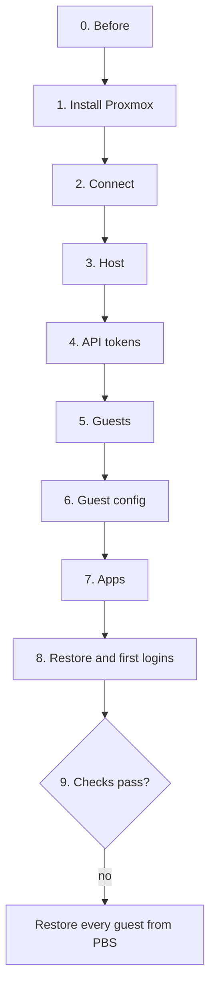

# Install

Rebuilding the server from a blank NVMe, one step at a time, with every command. Run the commands from
the repo folder on the Mac: most of them read `PVE_IP` from `homelab.env`. `make` steps are safe to re-run.



About 3 hours in total, most of it unattended. zsh treats `!` inside double quotes as history expansion,
which is why every command below that contains a token id like `tofu@pve!apply` uses single quotes outside.

## 0. Before

On the Mac (once): the tools, vault token, `homelab.env` and SSH key from [workstation.md](workstation.md),
then `make lint` passes.

On the old server, while it still runs:

- [ ] PBS backup of every guest, all succeeded. It's the way back if the rebuild fails.
- [ ] In Home Assistant: a long-lived token for Homepage and the Frigate MQTT login, then a full HA backup
      to the Mac and to nas.
- [ ] Wallos data to the Mac (CT and path as on the old server):
      `ssh root@<old host> "pct exec <ct> -- tar -C /opt/appdata -czf - wallos" > ~/Backups/wallos.tgz`
- [ ] Immich database dump: `... docker exec immich_postgres pg_dumpall -U postgres | gzip > ~/Backups/immich.sql.gz`
- [ ] FreshRSS feeds exported as OPML.

In the vault: every item in [credentials.md](credentials.md) exists, `changeme` where the app doesn't exist
yet. `immich/db_password` must be the live database's password. The `deploy` branch points at a green
commit (`make release`).

## 1. Install Proxmox (~15 min)

1. Unplug the USB disk, so the installer can't format it by mistake.
2. Boot the Proxmox VE ISO. Target disk: the NVMe (`nvme0n1`), default LVM layout. Root password: vault
   item `proxmox-root`.
3. Network screen:

   | Field | Value |
   |---|---|
   | Management interface | The wired `igc` NIC (its MAC is `PVE_MAC`), not the Wi-Fi |
   | Hostname (FQDN) | `pve.home.arpa`. The part before the dot must be `pve`. Not `pve.<domain>`: AdGuard's wildcard sends that name to Traefik |
   | IP / gateway | `PVE_IP` / 24, `HOMELAB_GATEWAY` |
   | DNS | `HOMELAB_DNS_VIP` (the RPi3 answers on it until CT 106 is up) |
   | Pin network interface names | On. The NIC becomes `nic0`, so `PVE_NIC=nic0` in `homelab.env` |

## 2. Connect (~5 min)

Forget the old host keys (same IPs, new keys), copy your key to the host, check it:

```bash
p=$(sed -n 's/^PVE_IP=\(.*\)\.[0-9]*$/\1/p' homelab.env); for h in 107 180 113 117 120 121 4 132 122 133 118; do ssh-keygen -R $p.$h; done
```
```bash
ssh-copy-id root@$(sed -n 's/^PVE_IP=//p' homelab.env)
```
```bash
ssh root@$(sed -n 's/^PVE_IP=//p' homelab.env) 'hostname; ip -br link'
```

Expect `pve`, and `nic0` and `vmbr0` up. The NIC name must match `PVE_NIC`: if it doesn't, fix
`homelab.env` (and its vault Note) before `make host`, or the host loses its network. Then plug the USB
disk back in. Don't format it.

## 3. Host (~10 min)

```bash
make host ENV=prod
```

Repos, microcode, kernel command line, the USB disk at `/mnt/external`, templates, the HAOS image, API
users, timers, alerts ([host-baseline.md](../host-baseline.md)). It ends by listing the four tokens still to
create. Then upgrade and reboot once (new kernel, microcode, command line):

```bash
ssh root@$(sed -n 's/^PVE_IP=//p' homelab.env) 'apt update && apt full-upgrade -y'
```
```bash
ssh root@$(sed -n 's/^PVE_IP=//p' homelab.env) reboot
```
```bash
ssh root@$(sed -n 's/^PVE_IP=//p' homelab.env) 'uname -r; grep -o "intel_iommu=on" /proc/cmdline; findmnt -no SIZE /mnt/external'
```

## 4. API tokens (~5 min)

Each command copies the token to the clipboard instead of printing it. Paste it into the vault item's
`password` field before running the next one.

```bash
ssh root@$(sed -n 's/^PVE_IP=//p' homelab.env) "pveum user token add tofu@pve plan --privsep 1 --expire \$(date -d '+1 year' +%s) --output-format json" | jq -r '"\(.["full-tokenid"])=\(.value)"' | pbcopy
```
→ `proxmox-tofu-plan` (`tofu@pve!plan=<secret>`)

```bash
ssh root@$(sed -n 's/^PVE_IP=//p' homelab.env) "pveum user token add tofu@pve apply --privsep 1 --expire \$(date -d '+1 year' +%s) --output-format json" | jq -r '"\(.["full-tokenid"])=\(.value)"' | pbcopy
```
→ `proxmox-tofu-apply` (`tofu@pve!apply=<secret>`)

```bash
ssh root@$(sed -n 's/^PVE_IP=//p' homelab.env) "pveum user token add monitoring@pve exporter --privsep 1 --expire \$(date -d '+1 year' +%s) --output-format json" | jq -r .value | pbcopy
```
→ `proxmox-exporter` (secret only)

```bash
ssh root@$(sed -n 's/^PVE_IP=//p' homelab.env) "pveum user token add monitoring@pve homepage --privsep 1 --expire \$(date -d '+1 year' +%s) --output-format json" | jq -r .value | pbcopy
```
→ `proxmox-homepage` (secret only)

Then add their permissions:

```bash
make host ENV=prod
```

## 5. Guests (~5 min)

```bash
make init ENV=prod
```
```bash
make plan ENV=prod
```

Expect `Plan: 10 to add, 0 to change, 0 to destroy.` Two of the ten need more than the apply token may do:
docker-hw is privileged, and the HAOS VM sets a boot order. Proxmox asks for `Sys.Modify` on `/` for both
([ADR 3](../adr/3-root-only-steps-in-ansible.md)). Grant it for this one run:

```bash
ssh root@$(sed -n 's/^PVE_IP=//p' homelab.env) 'pveum role add TofuBootstrap --privs Sys.Modify && pveum acl modify / --users tofu@pve --roles TofuBootstrap && pveum acl modify / --tokens "tofu@pve!apply" --roles TofuBootstrap'
```
```bash
make guests ENV=prod CONFIRM=yes
```

Answer `yes`. OpenTofu creates the guests, then `lxc_devices` adds mounts, passthrough and uid mapping
and restarts the containers. Revoke right after, whether it worked or not:

```bash
ssh root@$(sed -n 's/^PVE_IP=//p' homelab.env) 'pveum acl delete / --users tofu@pve --roles TofuBootstrap && pveum acl delete / --tokens "tofu@pve!apply" --roles TofuBootstrap && pveum role delete TofuBootstrap'
```

Commit the encrypted state (and the lock file, if `tofu init` touched it):

```bash
git add tofu/terraform.tfstate.d/prod tofu/.terraform.lock.hcl && git commit -m "OpenTofu: prod state after the rebuild" && git push
```

## 6. Guest config (~15 min)

Tailscale admin → Settings → Keys → Generate auth key: reusable off, ephemeral off, pre-approved on. Save it
in vault item `tailscale` → `password` (single-use, it expires). Then:

```bash
make config ENV=prod
```

`common` on every LXC, then Tailscale, Samba, AdGuard with keepalived and sync, Plex, PBS, Kasm (with its workspaces and VPN egress) and ClamAV.
PBS re-attaches the datastore on the USB disk and hands the old backup groups to the new token, which takes
several minutes the first time.

PBS token for Homepage's widget, copied to the clipboard:

```bash
ssh root@$(sed -n 's/^PVE_IP=//p' homelab.env) 'pct exec 108 -- proxmox-backup-manager user generate-token root@pam homepage --expire $(date -d "+1 year" +%s)' | sed 's/^Result: //' | jq -r .value | pbcopy
```
```bash
ssh root@$(sed -n 's/^PVE_IP=//p' homelab.env) 'for path in "/datastore/PVE-BCP DatastoreAudit" "/system Audit"; do pct exec 108 -- proxmox-backup-manager acl update $path --auth-id "root@pam!homepage"; done'
```

Vault item `pbs-homepage`: `username` = `root@pam!homepage`, `password` = the clipboard.

## 7. Apps (~10 min)

The state commit moved `main`. Once its CI run is green:

```bash
make release
```
```bash
make apps ENV=prod
```

Docker engines on docker-hw and docker-apps, Hawser on docker-hw and kasm, every stack secret, the core
stacks (socket-proxy, Traefik, Authelia, Dockhand), then Dockhand set up and every git stack deployed from
`deploy`.

## 8. Restore and first logins (~1 h)

Wallos is the only app with data to copy back. Stop it, unpack, start it:

```bash
ssh root@$(sed -n 's/^PVE_IP=//p' homelab.env) 'pct exec 109 -- docker stop wallos' && ssh root@$(sed -n 's/^PVE_IP=//p' homelab.env) 'pct exec 109 -- tar -C /opt/appdata -xzf -' < ~/Backups/wallos.tgz && ssh root@$(sed -n 's/^PVE_IP=//p' homelab.env) 'pct exec 109 -- docker start wallos'
```

Data on the USB disk (Immich, Frigate recordings, books, media) isn't touched by a rebuild. Everything else
starts empty:

| Service | First run |
|---|---|
| Home Assistant | Onboarding: restore the latest backup (Terminal & SSH comes back with it), then `make ha-deploy`. HA keeps its proxy settings in `.storage/http`, not the YAML: if `https://homeassistant.<domain>` answers 400, set Settings → System → Network → trusted proxies to docker-apps (`<lan>.122`) |
| Authelia | Log in and register 2FA. The one-time links: `ssh root@<PVE_IP> 'pct exec 109 -- docker exec authelia cat /data/notification.txt'` |
| Beszel | Create the login from vault item `beszel`, with the email from vault `authelia/email` (the hub trusts Authelia's `Remote-Email`, so that login is one-click; the password stays for Homepage). Add the systems: docker-apps as host `beszel-agent`, every other LXC by IP, port 45876 |
| Immich | Nothing: library and database are on the USB disk |
| Frigate | Settings → Users: the viewer from vault item `frigate` |
| Forgejo | Mirror the GitHub repos with the token from `github-forgejo` |
| changedetection | Add the watches, notifications to ntfy `homelab-personal` |
| FreshRSS | Create the user with Authelia's username, then switch it to Authelia's login: `ssh root@<PVE_IP> 'pct exec 109 -- docker exec -u abc freshrss php /app/www/cli/reconfigure.php --auth-type=http_auth'`. Import the OPML |
| Memos | Nothing: `make apps` creates your account (Authelia's username, vault item `memos`), adds "Continue with Authelia" and closes sign-ups, once Dockhand has deployed it. Then link it once: sign in with the vault password, Settings → My account → Linked accounts → Authelia |
| Vikunja, Linkding, Mealie | Nothing: the first Authelia login creates the user (Mealie makes Authelia's `admins` an admin) |
| Mealie (local admin) | At `/login?direct=1` as `changeme@example.com` / `MyPassword`: change both, or delete it once the Authelia user is admin |
| Calibre-Web | Log in as `admin` / `admin123`, change the password to vault item `calibre-web`'s (Admin → Edit user); Homepage's widget logs in with it |
| Plex | Claim it from localhost: `ssh -L 32400:localhost:32400 root@$PLEX_IP`, open `http://localhost:32400/web`, add the libraries. Pair Tautulli |
| Kasm | Nothing: `make config` installs it with the admin password from vault item `kasm` and creates the 8 workspaces and the ProtonVPN egress (`kasm-vpn`). Log in as `admin@kasm.local`. If sessions don't start: Admin → Infrastructure → Zones → Proxy Port 443 |
| RustDesk | Give the new public key (`/opt/appdata/rustdesk/hbbs/id_ed25519.pub` on docker-apps) to every client |
| Tailscale | Admin console: approve the subnet route and exit node, turn off key expiry for `tailscale` |

Last, replace the `changeme` placeholders in the vault with the real keys
([credentials.md](credentials.md#filling-the-vault-for-a-fresh-install)) and run `make apps ENV=prod` again
for the Homepage widgets and the Proxmox exporter.

## 9. Verify

- [ ] Plex transcodes on the iGPU; Frigate detects with the Coral; the webcam survives a replug; Immich ML
      runs.
- [ ] HA's Frigate integration connects and streams. Its RTSP URL template:
      `rtsp://<rtsp_user>:<rtsp_password>@<lan>.120:8554/{{ name }}` (vault item `frigate`).
- [ ] The Windows PC opens `\\nas\NAS` with the Samba login.
- [ ] Every `*.<domain>` host loads through Traefik and Authelia; Homepage widgets are green.
- [ ] File Browser shows Books, Downloads, Movies, Shared and Torrents, nothing else.
- [ ] Phone: HA app, Immich app, Tailscale exit node and subnet route.
- [ ] AdGuard: the VIP is on CT 106; `journalctl -u adguardhome-sync` there shows a sync to the RPi3.
- [ ] SSH with a password is refused: `ssh -o PubkeyAuthentication=no root@<host>`.
- [ ] ClamAV: put the EICAR test file into `Downloads` on the share, run
      `systemctl start clamav-scan@changed` on security, expect a `homelab-security` alert in about
      2 minutes. Delete the file.
- [ ] Alerts reach ntfy `homelab-infra`: Test on the `ntfy` target in Proxmox (Datacenter → Notifications)
      and in PBS (Configuration → Notifications), then `systemctl start homelab-pending-updates` on the host.
- [ ] The first PBS backup runs; Beszel and Grafana see every guest; Gatus on the RPi3 is all green.
- [ ] No drift: `make host-check`, `make devices-check ENV=prod`, `make config-check ENV=prod` and
      `make plan ENV=prod` show no changes.
- [ ] Restore drill: restore one small guest from PBS to a spare VMID, boot it, delete it.

## Restore every guest from PBS

If the checks fail and can't be fixed the same day:

1. Install Proxmox (steps 1-3).
2. Bring up something that can read the datastore (PBS itself isn't in it): either `make guests` plus the
   `pbs` role for CT 108 only, or `proxmox-backup-server` installed on the host for the time being.
3. Attach `/mnt/external/Backups`, add it as storage, restore every other guest.

That gets back the last backed-up state (at most 3 days old) within a few hours.
