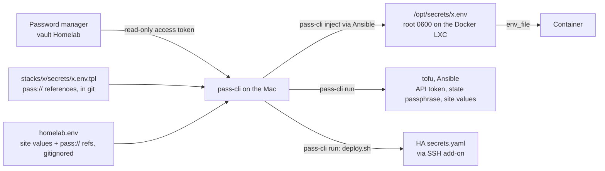

# Security

## Access model

- No app is exposed to the internet. Apps are reached over the LAN or Tailscale only, under one wildcard
  certificate (`*.<domain>`, Let's Encrypt via Cloudflare DNS-01). There are no Cloudflare tunnels and no
  public DNS records pointing home. The one exception is Plex: the router forwards 32400 to plex, an
  unprivileged LXC outside Traefik. Its Traefik route also strips the `Cookie` header, so the
  internet-exposed Plex never receives the Authelia session cookie.
- Authelia (forward-auth + OIDC) sits in front of the apps behind Traefik. Apps that speak OIDC (Dockhand,
  Grafana, Vikunja) log in through Authelia too, so one login covers them, and the Authelia group `admins`
  is the app admin. OIDC keys and client secrets are generated on docker-apps (`/opt/appdata/authelia/oidc`)
  and never leave it. Dockhand's local admin stays for automation (`/login?local=1`).
- The server only connects out. Dockhand polls GitHub, Renovate runs as a hosted app, CI runs on GitHub.
  No deploy credentials are stored in GitHub and nothing calls into the LAN.
- A push to `main` alone deploys nothing. Dockhand follows the `deploy` branch, and `make release` moves it
  only to a commit whose CI run passed, so a stolen GitHub session or a compromised Renovate app can't get a
  compose file onto the hosts without the operator ([ADR 4](adr/4-pull-based-deploys.md)).
- Infrastructure is applied by a person with `make` from the Mac. CI checks but never deploys.
- SSH is key-only on the host and every LXC: a drop-in (`/etc/ssh/sshd_config.d/10-homelab.conf`) sets
  `PermitRootLogin prohibit-password` and turns off password and keyboard-interactive login. The Proxmox
  root password still works for the web UI and the console.

## Privilege model

- Every LXC is unprivileged except docker-hw. nas, docker-apps and security map host uid/gid 1000-1001
  straight through (files on the USB disk are owned by 1000/1001); every other id stays shifted.
- docker-hw is privileged for the Coral TPU (whole-USB-bus passthrough) and the webcam replug workaround.
  This is an accepted trade-off, see below.
- The USB disk is mounted per folder. docker-apps gets only `Books`, `Downloads`, `Movies`, `Shared` and
  `Torrents`; docker-hw gets only `FrigateNVR` and `Personal/Immich`. Neither sees `Backups/` (the PBS
  datastore, which is uid 34 inside docker-apps' mapping) or `Proxmox/`. File Browser therefore sees only
  docker-apps' five folders. nas has the whole disk (with the vetoes below), security has it read-only, and
  pbs has only `Backups/`.
- OpenTofu has no root. It uses two Proxmox API tokens with privilege separation:
  - `tofu@pve!plan`: `PVEAuditor` (read-only), used for every `tofu plan`.
  - `tofu@pve!apply`: custom role `TofuApply` with what creating guests needs: VM allocate and config,
    power, datastore space and audit, network use, `Sys.Audit`. It has no user, ACL, storage or
    node-config management and no `Sys.Modify`.
  - Anything Proxmox reserves for `root@pam` (bind mounts, device passthrough, raw `lxc.*` lines,
    `keyctl`/`fuse`, uid mapping) is set by Ansible over SSH instead. Ansible also downloads the templates
    and the HAOS image, so the apply token doesn't need `Sys.Modify`
    ([ADR 3](adr/3-root-only-steps-in-ansible.md)).
- Backups to PBS use a token, not root. `pve@pbs!vzdump` may only back up to the one datastore (no deletes,
  no admin). The pbs role creates it and writes its secret straight into the host's root-only storage
  config; it is never shown or stored anywhere else.
- Docker sockets: only Dockhand, Hawser and the Dozzle agent on docker-hw use the real socket. Everything
  else goes through `wollomatic/socket-proxy`, which accepts only named clients (Traefik, Dozzle, Beszel,
  Alloy) and only GET on `_ping`, `version`, `info`, `events`, `networks`, and the container list, inspect,
  logs and stats. Container `archive` and `export` are blocked; `inspect` still returns a container's
  environment. The Dozzle agent reads the raw socket (its `:ro` mount only stops writes to the socket
  file), which is accepted. Dockhand sits on its own network shared only with Traefik, so app containers
  can't reach its API; Ansible reaches it on a port bound to 127.0.0.1.
- The Docker daemon on every Docker host sets `no-new-privileges` for all containers (except on kasm, where
  workspace images may use sudo) and rotates container logs.
- Loki and Prometheus are on a `monitoring` network that only Traefik, Grafana, Alloy and Homepage join,
  so a compromised app on `proxy` can't query or forge logs.
- The nas share (the USB disk, for the Windows PC) vetoes `Backups/` (the PBS datastore) and `Proxmox/`
  (host config archives): they can't be listed or opened over SMB. Guest access is off, and the share user
  has no shell login.

## Secrets

- Secret values exist in plain text only in the password manager and in root-only files on the target
  host. Git, CI and the docs hold `pass://Homelab/<item>/<field>` references only. Site values (domain,
  addresses, MACs) are not secret but stay out of the public repo: they live in the gitignored `homelab.env`, and
  `make leak-check` fails if one shows up in a tracked file ([ADR 2](adr/2-secrets-and-site-values.md)).
- The vault is read through a Proton Pass [access token](https://proton.me/blog/pass-access-tokens):
  read-only, limited to the `Homelab` vault, expires after a year, and lives in the macOS Keychain
  (`make login` uses it when the 2-hour session runs out).
- The Tailscale auth key goes through a root-only file in `/run` that exists only while `tailscale up`
  runs, so `ps` never shows it. Two bootstrap secrets still pass through a command line for a moment: Kasm's
  throwaway install passwords and the PBS token secret in `pvesm add` on the host.
- OpenTofu state is encrypted and committed ([ADR 1](adr/1-opentofu-encrypted-state.md)).
  OpenTofu refuses to write plaintext state or plans, and CI fails on any unencrypted `*.tfstate`.
- Break-glass: the password manager is reachable from other trusted devices (phone, another computer
  with 2FA), and the account recovery phrase is kept offline, so losing the Mac doesn't lock anyone out.

## Credentials

Every value is an item in the password manager vault `Homelab`.
[runbooks/credentials.md](runbooks/credentials.md) lists every item with its fields and how to rotate one.
They are reviewed once a year, aligned with the token expiries.

| Credential | Used by | Scope | Expiry / rotation |
|---|---|---|---|
| Password manager access token (Proton Pass) | `pass-cli` on the Mac (OpenTofu, Ansible) | `Homelab` vault, read-only | 1 year |
| Proxmox plan token `tofu@pve!plan` | `tofu plan` | `PVEAuditor` | 1 year; recreated after a reinstall |
| Proxmox apply token `tofu@pve!apply` | `tofu apply`/`destroy` | `TofuApply` (above) | 1 year; recreated after a reinstall |
| PBS backup token `pve@pbs!vzdump` | Host backups (storage `pve-bcp`) | `DatastoreBackup` on one datastore | Recreated by the pbs role (secret only on the host) |
| Proxmox exporter + Homepage tokens `monitoring@pve!exporter`, `!homepage` | prometheus-pve-exporter, Homepage | `PVEAuditor` (user and ACLs from `pve_host`, tokens by hand: `proxmox-exporter`, `proxmox-homepage`) | 1 year; recreated after a reinstall |
| PBS Homepage token | Homepage widget (`pbs-homepage`) | Datastore audit | 1 year |
| Mac SSH key | Ansible, root on the host and LXCs | Key-only login, enforced by `sshd_config.d/10-homelab.conf` | On device change |
| OpenTofu state passphrase | State + plan encryption | Decrypts the committed state | New key + `fallback` block |
| Cloudflare DNS token | Traefik DNS-01 | Zone Read + DNS Edit on one zone | 1 year |
| GitHub tokens (Dockhand, Forgejo mirror) | Git sync, pull mirror | One fine-grained token each, this repo only, contents read-only | ≤ 1 year |
| Renovate | Hosted Mend app | Installed on this repo only | Uninstall to revoke |
| ntfy sender tokens | Grafana, Scrutiny, ClamAV | `alerts` user, write-only on `homelab-*`, one per sender (`ntfy` item, field `token_<sender>`, `tk_` + 29 characters) | Per sender |
| Hawser tokens | Dockhand to Hawser on docker-hw and kasm (`hawser` item, one field per host), over TLS: each agent's key is made on its host by `core_stacks`, and Dockhand trusts exactly that certificate | Full Docker API on that host (docker-hw is privileged: root on the Proxmox host) | On suspicion; recreate both sides |
| Dozzle agent certificate | Dozzle and its agent on docker-hw, mutual TLS (`dozzle` item) | Reads docker-hw's container logs | On suspicion |
| ntfy phone login | ntfy app on the phone | Admin, reads every topic (`ntfy` item, username/password) | On suspicion |
| Frigate RTSP login | go2rtc restream on 8554; Home Assistant's Frigate integration (`frigate` item, `rtsp_user`/`rtsp_password`) | Camera streams | On suspicion; update HA's integration too |
| OIDC client secrets | Dockhand, Grafana and Vikunja login via Authelia | Generated on docker-apps by `core_stacks`, never leave the host | On reinstall |
| Homepage widget keys | Homepage | One read-only key or login per app | With the app |
| Tailscale auth key | `tailscale` role (bootstrap only) | Pre-approved, tagged | Expires by itself (≤ 90 days) |
| Service secrets (Authelia, app databases, keepalived, AdGuard sync, admin logins) | Stacks and roles | One item per stack, rendered to `/opt/secrets/<stack>.env` (0600) | On suspicion |

## Scanning and supply chain

| Stage | What runs |
|---|---|
| Every push and PR (CI) | gitleaks (full history), `trivy config` on OpenTofu and Ansible, yamllint, ansible-lint (production profile), `tofu fmt -check` and `tofu validate`, encrypted-state check, `make leak-check` (no `192.168.x.x` in tracked files), HA config check. `stacks/check.sh` renders every stack and fails on an image without a digest, a privileged container, host network or PID namespace, `cap_add` of SYS_ADMIN, SYS_PTRACE, SYS_MODULE or ALL, an `unconfined` security option, or a mount of the Docker socket or the folders holding it outside the listed services (`SOCKET_OK`: the socket proxies, the Dozzle agent, Dockhand, Hawser). Trivy has no compose scanner |
| CI tools | Actions pinned by SHA; yamllint and ansible-lint pinned in `requirements-ci.txt`; gitleaks, OpenTofu and Trivy versions pinned in `ci.yml` and bumped by Renovate regex managers; the gitleaks download is checksum-verified |
| Dependencies | Renovate with a 3-day minimum release age, pinned image digests and action SHAs, OSV + GitHub vulnerability alerts |
| Host downloads | Apt signing keys (Docker, Tailscale, Plex) and the HAOS image are checked against pinned SHA-256 sums; LXC templates against Proxmox's signed index |
| Running images | Dockhand scans deployed images (Grype/Trivy) locally |
| Hosts and LXCs | No agent. Daily unattended security upgrades, key-only SSH and the CI checks above; the host and Docker hosts send their journals to Loki, where Grafana alerts |
| Files on the USB disk | ClamAV on its own LXC (security), with the disk mounted read-only, so a scanner exploit can neither change files nor reach any login. A nightly 03:00 scan covers files changed in the last 2 days, and a weekly full scan runs Sat 01:00. `Backups`, `Proxmox`, `FrigateNVR` and `Personal/Immich` are not scanned, and files over 100 MB are skipped. It reports only and never moves or deletes anything. Limits: half a core, idle CPU/IO priority, 2 GB RAM (about 1 GB peak). A detection or failed scan goes to ntfy `homelab-security` (high) |
| Local `make lint` | `make leak-check` also fails on any plain value from `homelab.env` (6+ characters) in a tracked file; CI has no `homelab.env` |

## Accepted trade-offs

- docker-hw is privileged and shares USB bus 2 with the backup disk. Root in a privileged container is
  effectively root on the host. The N150 has a single USB controller, so every USB 3 device (the Coral,
  and the Seagate disk holding the backups) is on the same bus whatever port it uses, and whole-bus
  passthrough exposes both. Accepted because nothing on docker-hw is reachable from the internet (LAN and
  Tailscale only). An unprivileged docker-hw that receives only the Coral's device node,
  re-injected on re-enumeration the way `lxc-video-sync` does for the webcam, would avoid it.
- No host intrusion detection: nothing watches for changed system files, unusual logins or vulnerable
  packages from third-party repos. An agent-based HIDS costs more CPU and RAM than one N150 with nothing
  exposed to the internet justifies.
- Single physical node, so no compute high availability.
- No off-site backup ([ADR 7](adr/7-no-offsite-backup.md)). PBS, the host config backups
  and the data share one USB disk at home. Recovery point: up to 3 days (PBS every 3 days).
- The password manager must be reachable for a rebuild (mitigated by break-glass access).
- The Proxmox API certificate is self-signed, so OpenTofu, the Proxmox exporter and Homepage skip
  verification, and so does Traefik towards the other self-signed UIs (PBS, Kasm, PiKVM;
  `stacks/traefik/dynamic/services.yml`). Pinning their CAs would break on every reinstall.
  ACME certificates on the host and PBS would allow verification.
- Home Assistant, Plex, Immich and Frigate have no Authelia in front (their phone apps and Home Assistant's
  Frigate integration can't log in through it). They use their own logins, on LAN + Tailscale only.
- Home Assistant trusts docker-apps (.122) as its reverse proxy, so any container there could send it a
  forged `X-Forwarded-For`. `ip_ban_enabled` with a threshold of 5 failed logins limits guessing through
  Traefik.
- The socket proxy's container `inspect` returns environment variables, so a compromised Traefik, Dozzle,
  Beszel or Alloy can read other containers' env secrets.
- Dozzle trusts Authelia's `Remote-User` header and shares the `socket-proxy` network with Beszel and
  Alloy, so those two could reach it directly with a forged header. They can already read the same data
  through the proxy, so this grants nothing extra while Dozzle's actions and shell stay off.
- AdGuard sync to the RPi3 uses plain HTTP (the RPi3 is outside this repo), so the replica's admin
  password crosses the LAN unencrypted every 5 minutes. The sync reads its own AdGuard via 127.0.0.1.
- The repo is public, so guest MACs, VMIDs, host numbers and the encrypted state are readable by anyone.
  None of them grants access.
- Hardware passthrough (iGPU, Coral, webcam) can only be tested on the real server, not in CT 990.
- Dockhand starts with login off until `dockhand_config` creates the admin (seconds later, same run).
  In that window only processes on docker-apps or someone already past Authelia's 2FA can reach it, and
  if anyone else created the admin first, the role's login fails loudly instead of passing.
